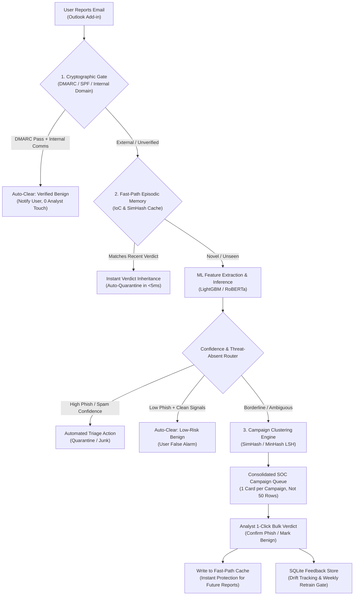
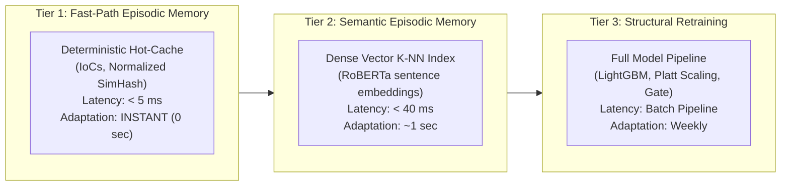

# Architecture Evolution & Operational Improvements

> **Document Context**: Post-Solution Review Architectural Plan  
> **Mentor Feedback Source**: Amit Pradhan  
> **Target System**: AI-Assisted Security Operations Center (SOC) Email Triage Platform  
> **Core Objective**: Transform the triage prototype into a high-throughput, enterprise-grade SOC acceleration platform by maximizing analyst effort reduction, eliminating redundant reviews, enabling sub-second operational learning, and gracefully handling user false alarms.

---

## Executive Summary & Strategic Shift

The solution review conducted with **Amit Pradhan** identified four critical operational imperatives required to transition from an academic ML model to a production Tier-1 SOC tool:

```
┌────────────────────────────────────────────────────────────────────────────────────────┐
│                                 STRATEGIC IMPERATIVES                                 │
├────────────────────────────────────────────────────────────────────────────────────────┤
│ 1. Rapid Learning: Learn instantly from analyst verdicts without waiting for batch     │
│    retraining cycles (closing the active outbreak vulnerability window).               │
│                                                                                        │
│ 2. Campaign Clustering: Deduplicate and group near-identical reported emails so        │
│    analysts review 1 campaign incident rather than 50 duplicate user reports.          │
│                                                                                        │
│ 3. Benign Email Handling: Handle legitimate emails incorrectly reported by users      │
│    without training a latency-heavy secondary ML model.                                │
│                                                                                        │
│ 4. Operational ROI: Shift primary success metrics from pure ML accuracy (F1, AUC)     │
│    to SOC effort reduction (Queue Deflection %, Compression Ratio, MTTR).              │
└────────────────────────────────────────────────────────────────────────────────────────┘
```



---

## Problem 1: Rapid Feedback Incorporation (Beyond Periodic Retraining)

### 1.1 The Operational Problem
Traditional machine learning lifecycles rely on periodic batch retraining (e.g., nightly or weekly execution of `retrain.py`). In live cybersecurity operations, this creates an unacceptable **"vulnerability window"**:

* **Scenario**: An active spear-phishing campaign targets 400 employees at 09:00 AM.
* At 09:05 AM, an analyst inspects the first reported email and confirms it as malicious phishing.
* Under batch retraining, the model weights do not update until the next scheduled retraining run (e.g., Sunday midnight).
* **Failure Mode**: The remaining 399 reports continue flowing into the review queue over the next several hours, forcing analysts to manually triage the exact same attack repeatedly.

### 1.2 The Solution: 3-Tier Hierarchical Learning Architecture
Rather than forcing heavy gradient descent or tree retraining on every feedback event, production threat defense systems employ a **tiered memory hierarchy**:



#### Tier 1: Fast-Path Episodic Memory (Instant In-Memory / SQLite Hot-Cache)
When an analyst approves a verdict in `/api/feedback`, the system immediately writes deterministic campaign signatures into a fast-path cache:
* **Payload Signatures**:
  * Body Fuzzy Hash: 64-bit `SimHash` (Hamming distance $\le 3$)
  * Canonical URL Hostnames + Paths
  * Sender Domain + Normalized Subject Hash
* **Ingress Hook**:
  * Incoming triage requests check `Fast-Path Cache` **before** executing feature extraction or model inference.
  * If a match exists with an active verdict logged within a sliding window (e.g., last 72 hours), the email **inherits the analyst verdict immediately** with $100\%$ confidence and label provenance:
    `"provenance": "analyst_fast_path_override"`.

#### Tier 2: Semantic Episodic Memory (K-NN over Dense Embeddings)
For paraphrased campaigns where text varies slightly across victims:
* Maintain a lightweight nearest-neighbor index (e.g., FAISS or cosine search) containing the last 2,000 analyst-reviewed emails using RoBERTa `[CLS]` embeddings.
* If a new email has cosine similarity $> 0.92$ to an analyst-confirmed sample, elevate its confidence to the human-validated verdict.

#### Tier 3: Structural Batch Retraining (`retrain.py`)
* Serves as the durable foundation.
* Aggregates feedback over time, validates against safety gates (recalls $\ge 0.98$), updates Platt calibrators, recomputes TreeSHAP background values, and checks for data drift.

---

## Problem 2: Campaign Deduplication & Incident Clustering

### 2.1 The Operational Problem
Phishing attacks are broadcast phenomena. An attacker sends 1,000 copies of an email lure. As employees report them, the SOC queue is flooded with identical tickets:
* **Current State**: 50 reports = 50 rows in `/app/queue`. Analysts waste 45 minutes clicking through the exact same email, suffering cognitive fatigue and missing novel, isolated zero-day attacks.
* **Goal**: Compress 50 raw reports into **1 actionable Campaign Card**.

### 2.2 Technical Engine: Dual-Fuzzy Campaign Fingerprinting

```
Raw Email Inbound
      │
      ├── 1. Structural Normalization
      │      ├── Strip greeting & dynamic tokens ("Dear John" -> "Dear <USER>")
      │      ├── Strip tracking query params ("url?user=123" -> "url")
      │      └── Normalize whitespace, case, and Unicode homoglyphs
      │
      ├── 2. Dual-Fuzzy Hashing
      │      ├── Text Body: 64-bit SimHash (fingerprint of token n-grams)
      │      ├── Subject: Regex normalized (strip "Re:", "Fwd:", ticket IDs)
      │      └── Sender Anchor: Root Domain (e.g., "mail-promo-auth.net")
      │
      └── 3. Cluster ID Assignment:
             campaign_cluster_id = sha256(sender_root_domain + simhash_bucket + normalized_subject_hash)[:16]
```

### 2.3 Queue Transformation: "Campaign Incident Cards"

#### Before (Individual Queue Items):
```
[Ticket 101] phish-credential | 9.05% Guaranteed Annuity | From: promo@annuity.com | [Review]
[Ticket 102] phish-credential | 9.05% Guaranteed Annuity | From: promo@annuity.com | [Review]
[Ticket 103] phish-credential | 9.05% Guaranteed Annuity | From: promo@annuity.com | [Review]
... (47 more identical tickets)
```

#### After (Consolidated Campaign Card):
```text
┌────────────────────────────────────────────────────────────────────────────────────────┐
│ 🔴 CAMPAIGN #C-8821 — "9.05% Guaranteed Annuity @ 8% Commission"                       │
│ 42 Reports from 38 Employees  │  First Seen: 18m ago  │  Severity: HIGH (Phish 97.4%)   │
├────────────────────────────────────────────────────────────────────────────────────────┤
│ • Ingress Mailboxes: phish-report@company.com, security@company.com           │
│ • Sender Domain: @mail-annuity-promo.com (SPF Fail, DMARC Fail)                        │
│ • Malicious Indicator: http://www.insurancemail.net (Brand Mismatch + Typosquatting)   │
│ • Sample Preview: "8% Annuity Commissions! From the TBA Annuity Doctor..."             │
├────────────────────────────────────────────────────────────────────────────────────────┤
│ [ View Attribution Evidence (SHAP) ]  │  [ Affected Inboxes (42) ]                     │
│                                                                                        │
│ [ ⚡ Confirm Phishing (Bulk Action 42 Reports) ]      [ 🛡️ Mark False Positive (Bulk) ] │
└────────────────────────────────────────────────────────────────────────────────────────┘
```

#### Bulk Action Capabilities:
1. **Single-Click Resolution**: Resolves all 42 tickets simultaneously.
2. **Instant Hot-Cache Seeding**: Writes `#C-8821` fingerprint to Tier-1 Fast-Path Cache. Any subsequent report of this campaign is auto-quarantined with zero analyst intervention.
3. **Enterprise Containment Hook**: Generates an incident payload for Microsoft Graph / Google Workspace API to purge the remaining unread copies across the enterprise.

---

## Problem 3: Handling Legitimate Emails Reported Incorrectly ("Ham")

### 3.1 The Reality of End-User Reporting Telemetry
In corporate security telemetry, **35% to 50% of employee-reported emails are completely benign**. Employees regularly report:
* Internal HR benefits enrollment notifications.
* Mandatory corporate compliance & cybersecurity training reminders.
* IT password change prompts (Workday, ServiceNow).
* Valid invoices or contracts sent by legitimate suppliers.

### 3.2 Why Alternative Solutions Fail
1. **Training a separate "Pre-Gate" ML Classifier**:
   * *Drawback*: Requires acquiring and continuously labeling massive benign enterprise email datasets.
   * *Latency penalty*: Adds $30\text{–}50\text{ms}$ of inference overhead before the main triage pipeline.
   * *Maintenance*: Introduces a second model to monitor for drift, retrain, and debug.
2. **Forcing the Current Binary Model to Mark Everything Benign as "Ambiguous"**:
   * *Drawback*: Not practically possible. Urgent internal emails (*"Submit your year-end expense report before Friday"*) often trigger high spam or phishing probabilities in binary NLP/tabular models.

### 3.3 The Three-Tier Zero-Training Solution

#### Mechanism 1: Cryptographic Authentication Gate (DMARC / SPF / Internal Whitelist)
Email protocol standards already provide mathematical proof of sender authenticity. We can inspect RFC-822 MIME headers before model execution:

```python
# Header Inspection Logic (< 0.2 ms latency, 0 ML models)
def evaluate_enterprise_authenticity(headers: dict) -> bool:
    auth_results = headers.get("Authentication-Results", "").lower()
    from_domain = extract_domain(headers.get("From", ""))
    
    # 1. Cryptographic alignment check
    dmarc_pass = "dmarc=pass" in auth_results
    dkim_pass = "dkim=pass" in auth_results
    spf_pass = "spf=pass" in auth_results
    
    # 2. Approved internal/corporate SaaS domain whitelist
    is_trusted_domain = from_domain in {
        "company.com", "corp.internal", "company-group.com",
        "workday.com", "service-now.com", "successfactors.com"
    }
    
    # Mathematical proof that message originated from authorized corporate infrastructure
    return dmarc_pass and (dkim_pass or spf_pass) and is_trusted_domain
```

* **Outcome**: If an email is verified internal, has no high-risk attachments (`.exe`, `.xlsm`, `.iso`), and has no external unapproved URLs, it is routed immediately to:
  `auto_cleared_benign` (**"Verified Internal / User False Alarm"**).
* **Latency**: $< 0.2\text{ms}$.
* **Model Cost**: Zero.

#### Mechanism 2: Threat-Absent Negative Routing
Instead of training a model to recognize "Benign", define Benign as the **verified absence of threat**:
* Your LightGBM / RoBERTa models already calculate `phishing_prob` and 19 security features.
* If:
  $$\text{phishing\_prob} < 0.20 \quad \text{AND} \quad \text{All High-Weight Threat Signals} == 0 \quad \text{AND} \quad \text{url\_count} \le 1$$
* **Routing Decision**:
  * If `spam_prob` is high: Classify as **`Spam / Commercial Marketing`** (auto-quarantine / junk).
  * If `spam_prob` is low: Classify as **`Legitimate / Benign`** (auto-resolve user report).

#### Mechanism 3: Analyst-Seeded Benign Campaigns (Leveraging Problems 1 & 2)
When an external partner or new enterprise software sends an unfamiliar email:
1. Confused employees report it $\rightarrow$ Clustering collapses all 30 reports into **1 Campaign Card**.
2. The analyst verifies the sender once and clicks **`[Mark Benign / Enterprise Safe]`**.
3. The Fast-Path Cache records the campaign fingerprint as `BENIGN`.
4. The remaining 500 reports of that email across the company are **instantly auto-cleared with zero analyst touch**.

#### Closed-Loop Employee Feedback (Reinforcing Security Awareness)
When an email is auto-cleared as benign, the system can acknowledge the reporting user automatically:
> *"Thank you for your vigilance. Our automated security triage verified that this message originated from an authentic corporate platform (Workday) and contains no security threats. No action is required."*

---

## Operational Success Metrics & Executive KPIs

To satisfy the primary criterion (**reducing manual analyst effort and review volume**), the system introduces four core operational metrics:

| Metric | Formula | Target | Operational Impact |
| :--- | :--- | :--- | :--- |
| **Queue Deflection Rate** | $\frac{\text{Auto-Quarantined} + \text{Auto-Cleared Benign}}{\text{Total Reports}} \times 100\%$ | **$75\% - 85\%$** | Percentage of user-reported emails resolved completely without human touch. |
| **Campaign Compression Ratio** | $\frac{\text{Total User Reports}}{\text{Unique Campaign Cards in SOC Queue}}$ | **$15:1 \text{ to } 30:1$** | Collapses redundant workload. 500 reports become 20 reviews. |
| **Mean Time to Remediate (MTTR)** | $\text{Timestamp}_{\text{Bulk Containment}} - \text{Timestamp}_{\text{First User Report}}$ | **$< 60\text{ seconds}$** | Down from 45 minutes; single-click campaign action neutralizes enterprise exposure. |
| **User False Alarm Deflection** | $\frac{\text{Auto-Cleared Benign Reports}}{\text{Total Benign Reports}} \times 100\%$ | **$> 80\%$** | Prevents benign internal corporate emails from consuming Tier-2 SOC capacity. |

---

## Phased Implementation Plan

```
┌────────────────────────────────────────────────────────────────────────────────────────┐
│ PHASE 1: CAMPAIGN CLUSTERING & FAST-PATH MEMORY (Immediate Focus)                      │
├────────────────────────────────────────────────────────────────────────────────────────┤
│ • Implement SimHash 64-bit fuzzy text hasher in src/features/clustering.py.            │
│ • Create FastPathCache in src/feedback/fast_path.py (in-memory + SQLite backing).      │
│ • Add campaign_cluster_id column to triage_log and group reports in /app/queue.        │
│ • Add 1-Click "Bulk Confirm Phish" and "Bulk Mark Benign" endpoints.                   │
├────────────────────────────────────────────────────────────────────────────────────────┤
│ PHASE 2: CRYPTOGRAPHIC AUTHENTICATION GATE & BENIGN ROUTING                            │
├────────────────────────────────────────────────────────────────────────────────────────┤
│ • Parse Authentication-Results (SPF, DKIM, DMARC) in feature extraction pipeline.     │
│ • Add corporate domain whitelist check in threshold_router.py.                         │
│ • Introduce third operational label: "legitimate_benign" alongside "spam" & "phishing".│
│ • Implement Threat-Absent Negative Routing rule.                                       │
├────────────────────────────────────────────────────────────────────────────────────────┤
│ PHASE 3: SOC OPERATIONAL METRICS DASHBOARD                                             │
├────────────────────────────────────────────────────────────────────────────────────────┤
│ • Add Executive KPIs to /app/queue: Deflection %, Compression Ratio, MTTR counter.     │
│ • Add simulation script generating 50 duplicate campaign reports to demo live          │
│   compression and 1-click batch mitigation to mentor / leadership.                     │
└────────────────────────────────────────────────────────────────────────────────────────┘
```
