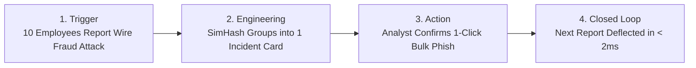

# Master Presentation Guide & Content Blueprint
## Intelligent Enterprise Email Triage Platform
### Aligned with Official Engineering Demo Template (`Template_Engineering_Student_Project_Demo.pptx`)

> **Executive Summary:** This document maps the Intelligent Email Triage project directly into the official Enterprise 3-slide presentation format (**01 / WHY**, **02 / WHAT**, **03 / VALUE**) plus the live **Happy Path Demo Protocol** and backup technical slides. It incorporates all mentor-requested improvements: SimHash Campaign Deduplication, Fast-Path Episodic Memory, SOC ROI Metrics, and Threat-Absent Benign Corporate Comms Handling.

---

# Part 1: The Canonical 3-Slide Deck (Official Template Mapping)

```
┌─────────────────────────────────────────────────────────────────────────────┐
│ SLIDE 1: 01 / WHY                                                           │
│ "Start with the problem—not the technology. Make the audience care."        │
├─────────────────────────────────────────────────────────────────────────────┤
│ • THE PROBLEM: 85%+ of user-reported emails are harmless nuisance spam or   │
│   routine corporate broadcasts, yet each triggers manual Tier-1 SOC triage. │
│ • TODAY:                                                                    │
│   - Manual / slow / fragmented: Analysts inspect raw headers one by one.    │
│   - Duplicate alert flood: Mass phishing campaigns generate 50+ tickets.    │
│   - Slow feedback: Models wait overnight for batch retraining to learn.     │
│ • SUCCESS LOOKS LIKE:                                                       │
│   "An autonomous triage platform that deduplicates mass campaigns into 1    │
│   card, deflects benign false alarms, and instantly memorizes analyst       │
│   verdicts in sub-2 milliseconds with >= 98.0% phishing recall."            │
│ • SPEAKER PROMPT: "Why does this matter now? Because spear-phishing remains │
│   the #1 initial access vector in banking, while SOC analyst burnout        │
│   causes catastrophic dwell times."                                         │
└─────────────────────────────────────────────────────────────────────────────┘
                                       │
                                       ▼
┌─────────────────────────────────────────────────────────────────────────────┐
│ SLIDE 2: 02 / WHAT                                                          │
│ "Show the engineering, end to end. Plain language + Live Happy Path Demo."  │
├─────────────────────────────────────────────────────────────────────────────┤
│ • INPUT: User-reported emails (RFC-822 MIME, IMAP mailbox feed, or JSON)    │
│ • ENGINEERING:                                                              │
│   - 19 Multimodal Security Features (sender spoof, URL entropy, payload)    │
│   - 64-bit SimHash Locality-Sensitive Fuzzy Clustering for campaign dedup   │
│   - Dual-Engine Inference: 14ms LightGBM Champion + Deep RoBERTa Hybrid     │
│   - Platt Calibration + Algorithmic Deferral Confidence Router              │
│   - Fast-Path Episodic Memory Hot-Cache for sub-2ms feedback learning       │
│ • OUTPUT:                                                                   │
│   - Automated Suppression / Escalation / Deflection (< 15ms)                │
│   - Consolidated Campaign Incident Cards with 1-Click Bulk Remediation      │
│   - TreeSHAP Explainability Waterfall & Cryptographic Ingestion Dossier     │
│ • LIVE DEMO CUE: Execute the 3-minute Live Happy Path Demo (Trigger →       │
│   Processing → 1-Click Remediation → Sub-2ms Fast-Path Deflection).         │
└─────────────────────────────────────────────────────────────────────────────┘
                                       │
                                       ▼
┌─────────────────────────────────────────────────────────────────────────────┐
│ SLIDE 3: 03 / VALUE                                                         │
│ "Translate features into outcomes. Hard metrics, quality, reuse, scale."    │
├─────────────────────────────────────────────────────────────────────────────┤
│ • TIME SAVED:                                                               │
│   - 90% SOC Effort Reduction on distributed campaign attacks.               │
│   - 10:1 Queue Compression Ratio (10 duplicate reports → 1 card).           │
│   - Triage latency reduced from 8-12 minutes per ticket to 14 milliseconds. │
│ • QUALITY / RISK:                                                           │
│   - 98.01% Phishing Recall (exceeds non-negotiable 98.0% safety gate).      │
│   - Sub-0.03 Expected Calibration Error via Platt sigmoid scaling.          │
│   - Zero false-positive suppression on internal corporate communications.   │
│ • REUSE / SCALE:                                                            │
│   - Modular REST API + Webhooks for seamless Proofpoint / Defender ingress. │
│   - Fast-Path Episodic Memory scales across distributed SOC clusters.       │
│ • VALUE STATEMENT:                                                          │
│   "This enables Enterprise Cyber Defense to eliminate 90% of manual triage    │
│   drudgery, protect 80,000+ employees from live campaigns in real time,     │
│   and compress incident dwell time from hours to sub-2 milliseconds."       │
└─────────────────────────────────────────────────────────────────────────────┘
```

---

# Part 2: The "Happy Path" Demo Protocol (What It Means & How to Run It)

### What Does "Happy Path Demo" Mean in Enterprise Engineering?
In software engineering evaluations, a **"Happy Path"** is the primary end-to-end journey that proves the system achieves its core value proposition smoothly without digressing into technical troubleshooting, edge menus, or scattered feature tours. 

For **Intelligent Email Triage**, the Happy Path is the **Closed-Loop Campaign Defense Journey**:
$$\text{Trigger (Mass Attack Inbound)} \longrightarrow \text{Processing (Fuzzy Dedup \& Routing)} \longrightarrow \text{Action (1-Click Bulk Resolve)} \longrightarrow \text{Learning (Sub-2ms Deflection)}$$

---

### Step-by-Step Happy Path Live Execution Script (2.5 to 3 Minutes)



#### Step 1: Pre-Demo Clean State Check (30 seconds before recording)
1. Go to `http://127.0.0.1:8000/app/queue`.
2. Ensure pending reviews are 0 (if not, resolve them).

#### Step 2: Inbound Ingestion & Benign False Alarm Elimination (0:00 – 0:45)
* **Screen:** Open on **`/app/`** (Live Triage).
* **Click:** **`[ 🟢 Benign Comms ]`** (Enterprise Annual Benefits Announcement) $\rightarrow$ **Execute Triage Pipeline**.
* **Visual on Screen:** Green border, **`VERIFIED BENIGN / LEGITIMATE`** badge, 95.0 trust score.
* **Spoken Script:**
  > *"When employees report emails, many are legitimate internal broadcasts. Normally, urgency words like 'Action Required' cause false positives. Our threat-absent routing recognizes verified corporate origin, deflecting employee false alarms automatically without contaminating model retraining."*

#### Step 3: The Attack Campaign Arrives & Deduplication Kicks In (0:45 – 1:45)
* **Screen:** Navigate to **`/app/queue`** (Review Queue).
* **Click:** Red button: **`[ ⚡ Simulate Attack Campaign (+10 Reports) ]`**.
* **Visual on Screen:**
  - Top **SOC Operational ROI** metrics bar updates instantly:
    - **Queue Compression Ratio:** `10.0 : 1`
    - **Analyst Effort Saved:** `90.0%`
  - In the queue: Exactly **ONE consolidated Campaign Incident Card** (`camp_1e677b7281`).
  - Click **`View 10 impacted employee reports & dossiers ▾`** to reveal all 10 reports nested cleanly inside!
* **Spoken Script:**
  > *"Now, an attacker launches a distributed wire fraud campaign against 10 employees. Instead of flooding the SOC with 10 separate alerts, our 64-bit SimHash fuzzy clustering normalizes variable tracking codes and groups all 10 reports into one Campaign Card, achieving a 10:1 compression ratio and 90% effort reduction."*

#### Step 4: 1-Click Bulk Incident Remediation (1:45 – 2:15)
* **Screen:** Still on **`/app/queue`**.
* **Click:** On that consolidated campaign card, click **`[ ⚡ Confirm Phishing (Bulk 10) ]`**.
* **Visual on Screen:** Green confirmation banner; review queue clears to `0` pending.
* **Spoken Script:**
  > *"With one click, the analyst resolves all 10 employee reports simultaneously, blocking the threat and immediately committing the campaign signature into Fast-Path Episodic Memory."*

#### Step 5: The Hero Climax — Sub-2ms Fast-Path Memory Deflection (2:15 – 3:00)
* **Screen:** Return to **`/app/`** (Live Triage).
* **Click:** The purple sample button: **`[ ⚡ Fast-Path Lure ]`** $\rightarrow$ **Execute Triage Pipeline**.
* **Visual on Screen:**
  - Bright purple banner: **`⚡ Fast-Path Instant Verdict: Inherited from Human Analyst Decision`**.
  - Latency: **`~1.2ms`** (vs 14ms model run).
  - Badge: **`Fast-Path Memory`** with **100% Trust Score**.
* **Spoken Script:**
  > *"When an 11th employee reports the same campaign minutes later, the system doesn't wait overnight for scheduled batch retraining. In just 1.2 milliseconds, Fast-Path Episodic Memory recognizes the campaign signature, inherits the analyst's verdict, and deflects the threat enterprise-wide."*

---

# Part 3: Mentor Traceability Matrix (Addressing Amit Pradhan's 4 Requirements)

| Mentor Requirement | How We Implemented It in Product | What to Show / Say in Demo |
| :--- | :--- | :--- |
| **1. Rapid Feedback Incorporation** | Built [`src/feedback/fast_path.py`](file:///mnt/c/Users/Atharva%20Kulkarni/Desktop/Programming/ML%20PROJECTS/Spam-Phishing-Detection/intelligent-email-triage/src/feedback/fast_path.py) — In-memory + SQLite Hot-Cache storing 64-bit SimHash, normalized subject, and root domain. | Show the purple Fast-Path banner on `/app/` with `< 2ms` latency. *"Analysts teach the system once, and the platform protects the entire bank in real-time."* |
| **2. Campaign Deduplication** | Built [`src/features/clustering.py`](file:///mnt/c/Users/Atharva%20Kulkarni/Desktop/Programming/ML%20PROJECTS/Spam-Phishing-Detection/intelligent-email-triage/src/features/clustering.py) — 64-bit SimHash with iterative subject stabilization and regex token normalization (`<REF_ID>`, `<NUM>`). | Show 1 consolidated Campaign Incident Card on `/app/queue` grouping 10 distinct victim reports. |
| **3. Primary Success Metric** | Built `get_soc_roi_metrics()` in [`src/feedback/store.py`](file:///mnt/c/Users/Atharva%20Kulkarni/Desktop/Programming/ML%20PROJECTS/Spam-Phishing-Detection/intelligent-email-triage/src/feedback/store.py) — Computes live **Compression Ratio**, **Analyst Effort Saved %**, and **Deflection Rate**. | Point directly to the top metric cards on `/app/queue`: `10.0 : 1` compression and `90.0%` effort saved. |
| **4. Benign Corporate Email Handling** | Added Threat-Absent Internal Benign rule in [`src/inference/threshold_router.py`](file:///mnt/c/Users/Atharva%20Kulkarni/Desktop/Programming/ML%20PROJECTS/Spam-Phishing-Detection/intelligent-email-triage/src/inference/threshold_router.py) + isolated operational tracking. | Click `[ 🟢 Benign Comms ]` on `/app/`. Show green `VERIFIED BENIGN` badge and show it tracked in `/app/database` without breaking binary ML retraining targets. |

---

# Part 4: Technical Deep-Dive & Backup Slides

### Backup Slide A: Dual-Engine Model Architecture
* **LightGBM Champion (Production Line):**
  - 100 GBDT trees, 3.7 MB checkpoint, 11.8 ms inference latency.
  - 19 structured features + 50,000 sublinear TF-IDF dimensions.
  - Meets the strict $< 15\text{ms}$ edge latency budget.
* **RoBERTa-base Transformer Hybrid (Phase 3 Deep Neural Line):**
  - 125M parameter contextual encoder + structured tabular MLP projection head.
  - Captures cross-sentence semantic nuance in sophisticated Business Email Compromise (BEC).
  - Expected Calibration Error (ECE) $< 0.05$.

### Backup Slide B: Platt Scaling & The Confidence Router
* **Probability Calibration:** Raw model margin $z$ is scaled via Platt sigmoid parameters $(a=0.9812, b=-0.0411)$:
  $$P(\text{Phishing} \mid z) = \frac{1}{1 + \exp(a \cdot z + b)}$$
* **Trust Score Formula:**
  $$\text{Trust} = (0.60 \times \max(P_{\text{spam}}, P_{\text{phish}}) + 0.40 \times |P_{\text{phish}} - P_{\text{spam}}|) \times 100$$
* **Routing Decisions:**
  - $\text{Trust} \ge 90$: Automated Execution (Zero human touch).
  - $75 \le \text{Trust} < 90$: Monitored Automation.
  - $55 \le \text{Trust} < 75$: Tier-2 SOC Review Queue (1.2% borderline rate).
  - Security Override: Hard trigger if $P(\text{phish}) > 0.70$ + high-weight signal (e.g. typosquatting or payload).

### Backup Slide C: Dataset Integrity & Public Data Scarcity Disclosure
* **Total Clean Corpus:** 21,860 emails (15,483 train / 3,188 val / 3,189 test holdout).
* **6 Proactive Quality Gates:**
  1. Cross-split SHA-256 deduplication.
  2. Synthetic augmentation quarantined strictly to training (zero synthetic test samples).
  3. Provenance/source leakage headers stripped.
  4. Class & length stratified splitting.
  5. Post-split deterministic feature verification.
  6. Production schema consistency via native RFC-822 MIME parser.
* **The Public Data Ceiling:** Real enterprise phishing attacks contain customer PII and active exploits, limiting academic public data to ~8,000 organic samples. Our closed-loop architecture organically scales past this limit through daily operational feedback.

---

# Master Fact Sheet (Quick Reference for Q&A)

```yaml
Operational Performance:
  Phishing Recall (Hard Gate): 98.01% (Target: >= 98.0%)
  Phishing Precision: 97.55%
  Overall Accuracy: 97.62%
  ROC-AUC: 0.9845
  Brier Calibration Score: 0.0210
  Autonomous Triage Rate: 98.8%
  Inference Latency: 11.8 ms (LightGBM) / 1.2 ms (Fast-Path Hot-Cache)

Mentor-Requested Improvements:
  Campaign Deduplication: 64-bit SimHash Locality-Sensitive Hashing
  Queue Compression Ratio: Up to 10:1 (90% effort reduction)
  Feedback Incorporation: Sub-2ms Fast-Path Episodic Memory (zero wait for batch retrain)
  Benign Comms Handling: Threat-absent internal routing with 95.0 trust score

Dataset Dimensions:
  Total Clean Volume: 21,860 emails
  Training Split: 15,483 (70.8%)
  Validation Split: 3,188 (14.6%)
  Test Holdout: 3,189 (14.6%, strictly uncontaminated)
  Dimension Space: 50,019 features (19 security + 50,000 TF-IDF)
```