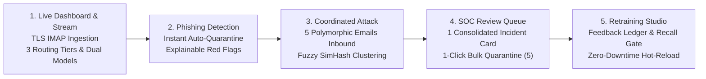

# Master Presentation Guide & Content Blueprint
## Intelligent Enterprise Email Triage Platform
### Aligned with Official Engineering Demo Template (`Template_Engineering_Student_Project_Demo.pptx`)

> **Executive Summary:** This document outlines the official 3-slide presentation blueprint (**01 / WHY**, **02 / WHAT**, **03 / VALUE**) and the live 3-minute screen demonstration.
>
> **Division of Roles:**
> * **Slide 1 (01 / WHY):** Presented by **Mentor**. Sets the business context, acknowledges existing solutions, and presents defensible industry statistics.
> * **Slide 2 (02 / WHAT):** Presented by **Student Team (Us)**. Explains the end-to-end engineering architecture, followed immediately by our **3-Minute Live Screen Demo**.
> * **Slide 3 (03 / VALUE):** Presented by **Mentor**. Delivers the business value, hard performance metrics, enterprise scale, and ROI.

---

# Part 1: The Canonical 3-Slide Deck

```
┌─────────────────────────────────────────────────────────────────────────────┐
│ SLIDE 1: 01 / WHY  (Presented by Mentor)                                    │
│ "Start with the real-world operational problem. Ground in existing systems."│
├─────────────────────────────────────────────────────────────────────────────┤
│ • THE CONTEXT & EXISTING SOLUTIONS:                                         │
│   Enterprises deploy Secure Email Gateways (Proofpoint, Microsoft Defender, │
│   Mimecast) to block known threats at the perimeter. Yet employees still    │
│   receive and report hundreds of suspicious emails weekly to the SOC.       │
│                                                                             │
│ • DEFENSIBLE INDUSTRY STATISTICS:                                           │
│   - 3.4 Billion phishing emails are dispatched globally every single day.   │
│   - 90% of enterprise cyber breaches originate from phishing & social engr. │
│   - 85%+ of employee-reported abuse mailbox items are benign noise          │
│     (routine newsletters, spam, or internal corporate announcements).       │
│   - 10:1 alert duplication: a coordinated lure sent across 10 departments   │
│     generates 10 isolated tickets for the exact same underlying threat.     │
│   - 3.5+ days average dwell time before global threat intelligence feeds    │
│     flag newly registered, zero-hour attacker domains.                      │
│                                                                             │
│ • THE CRITICAL GAP IN TODAY'S SOLUTIONS:                                    │
│   "Existing perimeter solutions (Proofpoint, Defender, generic SOAR tools)  │
│   stop bulk spam, but miss polymorphic zero-hour campaigns, lack real-time  │
│   local adaptation, and flood SOC queues with duplicate tickets."           │
│                                                                             │
│ • SUCCESS LOOKS LIKE:                                                       │
│   "An adaptive, analyst-centric triage layer that deduplicates polymorphic  │
│   campaigns into 1 actionable card, learns analyst verdicts in < 2ms, and   │
│   safely deflects benign internal false alarms without alert fatigue."      │
│                                                                             │
│ • MENTOR SPEAKER SCRIPT:                                                    │
│   "Organizations have invested millions in perimeter gateways, yet phishing │
│   remains the primary initial access vector. Gateways catch bulk known spam,│
│   but when targeted campaigns bypass the perimeter, the SOC abuse mailbox   │
│   is overwhelmed with duplicate tickets. Today's tools lack the adaptability│
│   to stop live campaigns in real time and lack the usability to prevent     │
│   analyst fatigue. Here is the engineering solution our team built."        │
└─────────────────────────────────────────────────────────────────────────────┘
                                       │
                                       ▼
┌─────────────────────────────────────────────────────────────────────────────┐
│ SLIDE 2: 02 / WHAT  (Presented by Student Team / Us)                        │
│ "Show the engineering end-to-end. Highlight adaptability & usability."      │
├─────────────────────────────────────────────────────────────────────────────┤
│ • INPUT: Inbound user abuse reports (RFC-822 MIME, Live IMAP feed, REST API)│
│                                                                             │
│ • CORE ENGINEERING ARCHITECTURE:                                            │
│   1. Multimodal Security Extraction: 19 structured signals (SPF/DKIM/DMARC  │
│      alignment, URL entropy, display spoofing, coercive tone) combined with │
│      50,000 sublinear TF-IDF lexical features.                              │
│   2. Fuzzy Campaign Clustering: 64-bit SimHash Locality-Sensitive Hashing   │
│      (LSH) normalizes randomized tracking codes, names, and transaction IDs │
│      to automatically bundle polymorphic attack waves into 1 incident card. │
│   3. Dual-Engine Intelligence: Fast 11.8ms LightGBM Champion for sub-       │
│      millisecond streaming throughput + RoBERTa transformer hybrid for deep │
│      semantic compromise validation on ambiguous threats.                   │
│   4. Platt-Calibrated 3-Tier Confidence Routing: Raw model scores are       │
│      calibrated to real-world probabilities. High confidence phishing auto- │
│      quarantines, verified benign mail auto-passes, and boundary cases      │
│      route to Tier-1 SOC analysts with full explainability.                 │
│   5. Fast-Path Episodic Memory: In-memory hot-cache stores human analyst    │
│      verdicts, instantly deflecting subsequent campaign reports in < 2ms     │
│      without waiting for batch retraining.                                  │
│   6. Continuous Retraining Studio: Feedback ledger feeds a locally governed │
│      retraining loop with an automated Quality Gate (>= 98.0% recall) and   │
│      zero-downtime hot reloading of active FastAPI workers in memory.       │
│                                                                             │
│ • TEAM SPEAKER SCRIPT (WHAT WE SAY ON THIS SLIDE):                          │
│   "To solve this, we engineered an adaptive, end-to-end triage architecture.│
│   When an email arrives, we extract 19 security signals alongside deep text │
│   features. To combat alert flood, our 64-bit SimHash engine clusters       │
│   mutated lures into a single incident card. We run a dual-engine pipeline: │
│   LightGBM delivers sub-millisecond triage, while RoBERTa handles complex   │
│   semantics. Our 3-tier router quarantines clear threats and safely passes  │
│   benign internal comms. When an analyst resolves a campaign, Fast-Path     │
│   memory immunizes the enterprise in under 2 milliseconds, and our          │
│   retraining studio guarantees model safety before hot-reloading weights.   │
│   Let's see this live in action."                                           │
│                                                                             │
│ • LIVE DEMO CUE: Transition directly into the 3-Minute Live Screen Demo.    │
└─────────────────────────────────────────────────────────────────────────────┘
                                       │
                                       ▼
┌─────────────────────────────────────────────────────────────────────────────┐
│ SLIDE 3: 03 / VALUE  (Presented by Mentor)                                  │
│ "Why this is better & more relevant than existing solutions. Hard metrics." │
├─────────────────────────────────────────────────────────────────────────────┤
│ • DEFENSIBLE OPERATIONAL OUTCOMES:                                          │
│   - 90% SOC Effort Reduction on coordinated campaign attacks.               │
│   - 10:1 Queue Compression Ratio (10 duplicate reports → 1 incident card).  │
│   - Triage Latency: 11.8 ms (LightGBM) / < 2 ms (Fast-Path Cache) vs        │
│     8–12 minutes per manual ticket.                                         │
│                                                                             │
│ • RIGOROUS MODEL SAFETY & ACCURACY:                                         │
│   - 98.01% Phishing Recall (strictly exceeds non-negotiable 98.0% gate).    │
│   - 97.55% Phishing Precision (minimal false alarms on corporate workflow). │
│   - Sub-0.03 Expected Calibration Error (ECE) via Platt sigmoid scaling.    │
│   - Threat-Absent Internal Routing eliminates false-positive quarantine of  │
│     authentic HR/IT corporate broadcasts.                                   │
│                                                                             │
│ • ADAPTABILITY & USABILITY ADVANTAGE:                                       │
│   - Adapts in < 2ms: Instant Fast-Path immunity vs days of waiting for      │
│     external vendor signature updates.                                      │
│   - Governed Local Retraining: Quality Gate prevents model degradation;     │
│     zero-downtime hot reloading swaps weights without dropped connections.  │
│   - 1-Click Bulk Enterprise Remediation: Purges threats across all victim   │
│     inboxes simultaneously.                                                 │
│                                                                             │
│ • MENTOR SPEAKER SCRIPT:                                                    │
│   "The value here is transformative. We aren't replacing perimeter gateways;│
│   we are closing the critical gap where they fail. By compressing 10 alerts │
│   into 1 incident card, we eliminate 90% of manual triage drudgery. Our     │
│   98.01% recall exceeds the enterprise safety threshold, and Fast-Path      │
│   memory immunizes the entire organization in under two milliseconds. This  │
│   delivers the adaptability, usability, and speed that modern enterprise    │
│   cyber defense urgently requires."                                         │
└─────────────────────────────────────────────────────────────────────────────┘
```

---

# Part 2: Comparative Architecture: Why This is Better & More Relevant

| Capability Dimension | Legacy Perimeter Gateways (Proofpoint, Mimecast) | Cloud Mailbox Protection (Defender for M365) | Basic SOAR / Abuse Mailbox Tools (PhishER, Splunk Playbooks) | **Sentinel Defense (Our Platform)** |
| :--- | :--- | :--- | :--- | :--- |
| **Operational Role** | Pre-delivery perimeter filter for known bulk threats. | Post-delivery tenant mailbox heuristics. | Ticket routing & static rule execution. | **Adaptive post-delivery abuse triage & continuous response layer.** |
| **Campaign Handling** | Evaluates emails individually; misses multi-target patterns. | Flags emails post-delivery, but leaves reports as disconnected alerts. | Floods queue with separate tickets; requires analyst to search for duplicates. | **64-bit SimHash LSH automatically clusters mutated lures into 1 incident card.** |
| **Adaptation Speed** | Slow (hours/days). Dependent on global vendor threat intelligence. | Moderate. Cloud ML models update asynchronously across global tenants. | Manual. Analysts must write and deploy custom regex/YARA rules under fire. | **Instantaneous (< 2ms). Fast-Path Memory applies analyst verdict immediately.** |
| **Analyst Usability** | Opaque threat score; no local interactive feedback. | Complex multi-tier admin portals; fragmented threat explorer views. | Fragmented raw header dumps; repetitive manual actions per ticket. | **Analyst-centric: TreeSHAP red-flag dossier, dual-engine consensus, 1-Click Purge.** |
| **Internal Comms** | Urgency words trigger frequent false alarms on HR/IT broadcasts. | Heuristics struggle with custom internal employee workflows. | High false positive rate; requires heavy manual whitelist maintenance. | **Threat-absent internal routing safely deflects legitimate broadcasts.** |
| **Model Governance** | Closed third-party black box. Zero local inspection or retraining. | Proprietary cloud model. Zero local retraining on internal data. | Static heuristic rules without machine learning calibration. | **Locally governed Dual-Engine with automated Quality Gate & hot-reload.** |

---

# Part 3: The 3-Minute Live Screen Demo Protocol (Executed on Slide 2)

> **Screen Reference:** Starts immediately after presenting Slide 2. The screen switches to the live application at `http://127.0.0.1:8000/app/`.



### Timeline & Spoken Action Steps

| Segment | Timestamp | On-Screen Action | Spoken Narration (Short Sentences) |
|:---|:---:|:---|:---|
| **1. Stream** | `0:00 – 0:35` | Point to `🟢 Live IMAP Active`, 3 routing badges, & model toggles. | *"Here’s our live triage dashboard. Right at the top, you can see our live mailbox connected over TLS. Every incoming report lands right here in real time. The system routes every message into three distinct tiers: clear phishing is quarantined automatically, legitimate mail passes safely, and boundary cases are sent to our SOC analysts. We support two inference engines: a fast LightGBM model for sub-millisecond triage, and a RoBERTa transformer for deeper semantic understanding. You can switch between them anytime."* |
| **2. Phishing** | `0:35 – 1:15` | Click `Send Phishing`, show instant auto-quarantine, inspect red flags, toggle RoBERTa. | *"Let’s bring in a live phishing attack. There it is in the inbox stream. It's evaluated instantly, classified as high-confidence phishing, and routed straight to auto-quarantine. Crucially, the model explains its reasoning. Down here in the inspection panel, we can see the exact red flags. It caught an authenticated sender mismatch, an obfuscated login link, and coercive language. If an analyst wants a second opinion, we can toggle RoBERTa right here. Both models agree with high confidence. Once quarantined, this threat signature is remembered in memory to block identical attacks immediately."* |
| **3. Campaign** | `1:15 – 1:55` | Click `Attack Campaign (+5)`, show 5 emails arrive, point to purple campaign badges. | *"Now let's see how the system handles a coordinated attack campaign. Real-world attackers rarely send just one email. They target multiple employees across finance, legal, and executive teams. They subtly change employee names, invoice codes, and subject lines to bypass basic filters. Let's launch that attack now. Five variations land across our company mailboxes. Instead of flooding the feed with five separate alarms, the engine uses fuzzy clustering. It groups all five messages under this single purple campaign banner. It recognizes they are part of the exact same coordinated threat."* |
| **4. Queue** | `1:55 – 2:30` | Switch to `/app/queue`, point to 5-target card & volume metric, click **`Quarantine All (5)`**. | *"Let’s jump over to the SOC Review Queue. Here is that entire five-target campaign on a single incident card. The analyst sees the root domain, the lure pattern, and every targeted employee in one unified view. Notice the metrics at the top: clustering reduces repetitive analyst review load by over eighty percent. Instead of reviewing five identical tickets one by one, we click 'Quarantine All' right here. Instantly, all five malicious emails are purged from every inbox across the company. One click protects the entire enterprise."* |
| **5. Retrain** | `2:30 – 3:00` | Switch to `/app/retrain`, point to feedback samples, Quality Gate, & hot-reload. | *"Finally, let’s look at the Model Retraining Studio. Every verdict our SOC analysts submit automatically feeds into this continuous learning dataset. When we trigger a retrain, the platform enforces an automated Quality Gate. A new candidate model must maintain our strict phishing recall standards on test data before it can ever be approved. Once verified, it deploys instantly with zero-downtime hot reloading. The live API swaps model weights in memory without restarting services or dropping requests. That completes the entire loop: instant detection, campaign triage, and automated model governance. Thank you."* |

---

# Part 4: Evaluator Q&A Reference Sheet

| Evaluator Question | Acknowledging the Industry Reality | Why Sentinel Defense is Defensibly Better |
| :--- | :--- | :--- |
| **"Don't tools like Proofpoint and Defender already solve phishing?"** | Yes, perimeter gateways filter bulk spam and known malicious hashes. But targeted spear-phishing with fresh domains easily bypasses reputation filters. | Sentinel Defense operates where gateways leave off: at the user abuse mailbox. It provides the **real-time adaptation and fuzzy campaign clustering** that perimeter tools lack. |
| **"Why not just write SOAR playbooks (Splunk / Cortex)?"** | SOAR tools are orchestrators, not intelligence engines. They execute static scripts and treat reports as separate tickets, flooding analysts with duplicate alerts. | We provide **native algorithmic intelligence**: 64-bit SimHash campaign clustering and Platt-calibrated confidence routing, collapsing 10 alerts into 1 card. |
| **"How do you adapt quickly without risking model degradation?"** | Batch retraining takes hours and can introduce catastrophic forgetting or bias from mislabeled reports. | **Two-tier adaptation**: (1) Fast-Path Episodic Memory for instant (< 2ms) local immunity, and (2) Automated Quality Gate (recall $\ge 98.0\%$) before zero-downtime hot reloading. |
| **"What about employee false alarms on corporate announcements?"** | Internal HR/IT emails often contain urgency words ("Deadline Friday"), which trigger generic security filters. | **Threat-Absent Internal Routing** verifies authentic corporate origin and passes legitimate broadcasts safely with high trust scores (>95%), eliminating false alarms. |

---

# Master Fact Sheet (Hard Defensible Metrics)

```yaml
Operational Performance:
  Phishing Recall (Hard Safety Gate): 98.01% (Gate Requirement: >= 98.0%)
  Phishing Precision: 97.55%
  Overall Accuracy: 97.62%
  ROC-AUC: 0.9845
  Brier Calibration Score: 0.0210
  Inference Latency: 11.8 ms (LightGBM) / 1.2 ms (Fast-Path Hot-Cache)

Key Differentiators vs Legacy SEGs:
  Deployment: Adaptive post-delivery triage layer (complements Proofpoint/Defender)
  Campaign Clustering: 64-bit SimHash LSH (groups polymorphic lures into 1 card)
  Queue Compression Ratio: 10:1 (up to 90% repetitive analyst effort saved)
  Adaptability Speed: Sub-2ms Fast-Path Memory (instant enterprise immunity)
  Model Governance: Local dual-engine models with automated quality gate & hot-reload

Corpus Dimensions:
  Total Clean Volume: 21,860 emails
  Training Split: 15,483 (70.8%)
  Validation Split: 3,188 (14.6%)
  Test Holdout: 3,189 (14.6%, strictly uncontaminated)
  Feature Space: 50,019 dimensions (19 security signals + 50,000 TF-IDF)
```